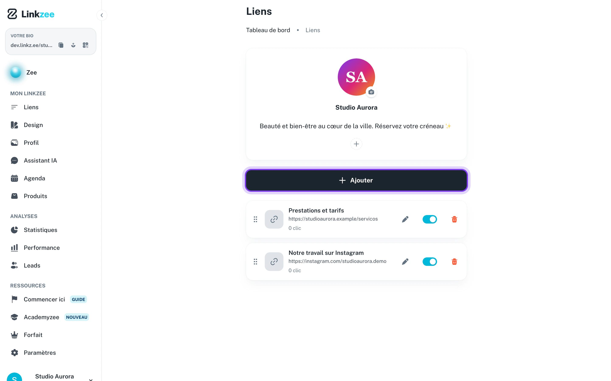
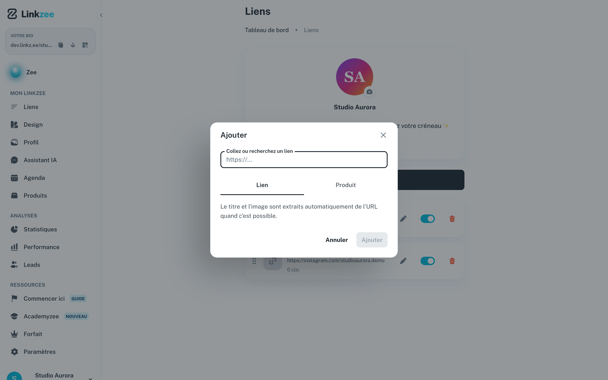

Les liens sont le cœur de votre page Linkzee. Ajoutez n'importe quelle URL que
vous souhaitez partager — un article de blog, un code promo, une vidéo YouTube,
votre boutique — et elle apparaît aussitôt sur votre page.

<Frame caption="Mon Linkzee : votre en-tête, le bouton Ajouter et tous vos liens en une liste.">
  
</Frame>

## Ajouter un lien

<Steps>
  <Step title="Ouvrez l'écran Contenu">
    C'est là que vous construisez votre page.
  </Step>
  <Step title="Cliquez sur + Ajouter">
    Utilisez le bouton pleine largeur **+ Ajouter**, puis choisissez **Lien**.
  </Step>
  <Step title="Saisissez les détails">
    Saisissez un **titre** et collez l'**URL**. C'est tout — le lien apparaît
    instantanément sur votre page.
  </Step>
</Steps>

<Frame caption="La fenêtre Ajouter : lien, produit, réseau social ou soutien — tout part d'ici.">
  
</Frame>

<Note>
  Tout est enregistré automatiquement au fil de votre saisie — il n'y a pas de
  bouton **Enregistrer**. Votre aperçu en direct se met à jour en temps réel, à
  droite sur ordinateur et sous l'éditeur sur mobile.
</Note>

## Liens WhatsApp

Envie d'un lien qui ouvre une **conversation WhatsApp** avec vous ? En
ajoutant un lien, choisissez la destination **WhatsApp** : renseignez votre
numéro et un message prérempli facultatif, et Linkzee construit le lien
`wa.me` correct pour vous — sans bricoler d'URL. Fonctionne aussi sur les
boutons produit.

## Ajouter un média à un lien

Un lien peut être plus qu'un texte — donnez-lui une carte visuelle :

| Média | Ce qu'il fait |
| --- | --- |
| **Image** | Une photo ou vignette affichée sur la carte ; les visiteurs peuvent la toucher pour la voir en plein écran. |
| **Vidéo** | Un court clip (jusqu'à **60 secondes / 40 Mo**) qui se lit directement sur votre page. |
| **Intégration** | Collez une URL **YouTube ou Vimeo** et le lecteur est intégré sur la carte. |

Ouvrez n'importe quel lien et choisissez le type de média dans l'éditeur de
lien. Pour intégrer une vidéo, choisissez l'option **Intégration** et collez-y
l'URL YouTube ou Vimeo.

## Blocs Avant / Après et Galerie

En plus des liens avec média, votre page peut afficher des **blocs photos** —
des cartes dont le contenu est constitué des photos elles-mêmes, sans URL de
destination (fonction Premium) :

| Bloc | Ce qu'il fait |
| --- | --- |
| **Avant / Après** | Deux photos superposées avec une **ligne glissante** : le visiteur la fait glisser pour comparer le résultat. Vous pouvez renommer les étiquettes « Avant »/« Après » et choisir où la ligne démarre. |
| **Galerie** | **De 2 à 10 photos** que le visiteur fait défiler, avec des points et un compteur. |

<Steps>
  <Step title="Cliquez sur + Ajouter et choisissez Avant / Après ou Galerie">
    Chaque bloc a son propre éditeur. Les blocs photos ne vont pas dans les collections.
  </Step>
  <Step title="Ajoutez les photos">
    L'Avant / Après utilise exactement deux photos (avant à gauche, après à
    droite). Pour une galerie, ajoutez 2 à 10 photos — sur ordinateur, glissez
    les fichiers directement depuis un dossier vers la zone des photos — et
    glissez les vignettes pour les réordonner. Besoin d'ajuster une photo ?
    **Recadrer** permet de la déplacer et de zoomer dans le cadre, comme la photo
    de profil — ce que vous voyez est ce qui est publié. Utilisez des photos au même cadrage — le **4:5
    (portrait)** fonctionne le mieux ; les photos aux proportions différentes
    sont recadrées sur les bords.
  </Step>
  <Step title="Confirmez que vous avez l'autorisation">
    Les photos de clients sont des données personnelles. Cochez la case
    confirmant que les personnes photographiées ont autorisé la publication —
    c'est obligatoire une fois par bloc, et la date de votre confirmation est
    conservée.
  </Step>
  <Step title="Enregistrez">
    L'aperçu dans l'éditeur montre le bloc réel avant l'enregistrement. Les
    photos sont envoyées quand vous cliquez sur **Enregistrer** ; un bloc auquel
    il manque des photos reste masqué sur votre page tant qu'il n'est pas
    complet.
  </Step>
</Steps>

<Note>
  Les blocs photos sont **Premium**. Avec l'offre gratuite, vous pouvez les
  composer et les prévisualiser, mais l'enregistrement demande un abonnement.
  La légende facultative s'affiche sur les photos ; le nom du bloc est interne
  (il vous aide, vous et Zee, à le retrouver). Les blocs photos ne reçoivent pas
  l'effet de mise en avant animé : les photos sont au centre.
</Note>

### En faire une section Résultats

Un bloc **Avant / Après** peut devenir une véritable section **Résultats**,
façon vitrine :

- **Titre de la section :** c'est le **nom du bloc** (ex. : « Résultats »).
- **Légende et sous-titre** s'affichent sur la photo, sur un dégradé sombre en
  bas (ex. : « Prothèse capillaire » · « Résultat le jour même »).
- **Bouton « Je réserve » :** choisissez une prestation de votre Agenda dans le
  champ **Bouton « Je réserve »** et le client arrive directement sur la
  réservation de cette prestation, sans la choisir à nouveau. Le bouton
  n'apparaît que si la prestation est active et que l'Agenda est inclus dans
  votre forfait.
- **Galerie en miniatures :** dans une Galerie, choisissez **Affichage →
  Miniatures**. Placée juste sous l'Avant / Après dans votre liste, elle
  rejoint la même section : 3 miniatures et **Galerie (N)**, qui ouvre toutes
  les photos en plein écran (avec le bouton « Je réserve » si une prestation
  est liée).

Un Avant / Après sans sous-titre, prestation ni galerie en miniatures
s'affiche comme avant.

### Vitrine verticale

Une **Galerie** peut aussi devenir une **Vitrine verticale** : des cartes hautes
de photos et de vidéos, côte à côte comme des stories. Elle est faite pour les
portfolios, les looks et les réalisations (par exemple, « Nos réalisations »).

<Steps>
  <Step title="Choisissez la disposition">
    Dans l'éditeur de la galerie, réglez **Affichage → Vitrine verticale**. Le
    nom du bloc devient le titre de la section sur votre page (par exemple,
    « Portfolio »).
  </Step>
  <Step title="Ajoutez des photos et des vidéos">
    Ajoutez **2 à 10 éléments** au format vertical (**9:16**). Les photos vont
    jusqu'à 8 Mo chacune ; les vidéos **MP4 ou MOV** jusqu'à 40 Mo. Les vidéos
    sont optimisées automatiquement pour charger vite et gardent leurs
    **30 premières secondes**. Pendant l'optimisation, une vidéo affiche
    **Optimisation…** et apparaît sur votre page dès qu'elle est prête.
  </Step>
  <Step title="Nommez chaque élément">
    Le nom s'affiche sur la carte (jusqu'à 40 caractères).
  </Step>
  <Step title="Choisissez l'action au toucher">
    Chaque élément a une **Action au toucher** : **Services** (un bouton « Je
    réserve » qui mène directement à la réservation de cette prestation),
    **Produits** (un bouton « Je le veux » qui ouvre le produit), **Commander
    sur WhatsApp**, **Sans bouton** ou **Par défaut du bloc**. L'**Action par
    défaut des photos** s'applique à chaque élément sans prestation ni produit
    propre.
  </Step>
</Steps>

Sur votre page, le visiteur touche une carte pour l'ouvrir en plein écran,
puis touche les bords ou glisse pour voir la suivante. Les vidéos démarrent
sans son, et le visiteur peut activer le son ou mettre en pause. **Tout voir
(N)** ouvre tous les éléments.

**Commander sur WhatsApp** ouvre une conversation avec le numéro de votre
boutique, avec un message prêt qui nomme l'élément et un lien vers cette
photo. Le lien affiche un aperçu de la photo à l'envoi, pour que vous sachiez
exactement quelle pièce le client veut. Pour l'utiliser, ajoutez le numéro
WhatsApp de votre boutique dans **Réseaux**.

<Note>
  Avec des vidéos, la galerie reste en disposition Vitrine verticale. Retirez
  les vidéos pour passer à une autre disposition. La case d'autorisation couvre
  aussi la voix des personnes dans les vidéos et, pour les mineurs, le
  consentement des parents ou tuteurs.
</Note>

## Mise en avant animée

Vous voulez qu'un lien se démarque ? L'éditeur de lien propose un effet de
**mise en avant animée** qui attire l'œil vers cette carte sur votre page
publique — le même effet est disponible sur les produits. C'est une
**fonctionnalité premium** : enregistrer un lien avec cet effet nécessite que
**cette boutique** soit sur une offre payante — si la boutique que vous modifiez
est en Free, l'éditeur vous invite à passer à une offre supérieure (voir
[Offres et tarifs](/fr/billing/plans) et
[Un forfait par boutique](/fr/billing/plan-per-store)).

## Gérer vos liens

Chaque lien dispose de quelques commandes pour garder votre page exactement
comme vous le souhaitez.

| Commande | Ce qu'elle fait |
| --- | --- |
| Crayon | Modifiez le titre en ligne, directement à sa place. |
| Interrupteur activé/désactivé | Affichez ou masquez le lien sans le supprimer. |
| Compteur de clics | Voyez combien de fois les visiteurs ont touché le lien. |
| Poignée de déplacement | Réorganisez les liens en les faisant glisser vers le haut ou le bas. |
| Supprimer | Retirez le lien — une confirmation vous sera d'abord demandée. |

La réorganisation se fait en direct : faites glisser un lien et l'aperçu suit,
puis le nouvel ordre s'enregistre tout seul.

## Regrouper les liens en collections

Lorsque vous avez beaucoup de liens, regroupez-les en **collections** pour créer
des sections nommées sur votre page — comme « Mes formations » ou « Codes promo ».
Cela garde votre page ordonnée et facile à parcourir.

<CardGroup cols={2}>
  <Card title="Collections" icon="folder" href="/fr/your-page/collections">
    Regroupez vos liens en sections nommées sur votre page.
  </Card>
  <Card title="Votre page" icon="table-cells" href="/fr/your-page/overview">
    Construisez et organisez tout sur votre écran Contenu.
  </Card>
</CardGroup>
