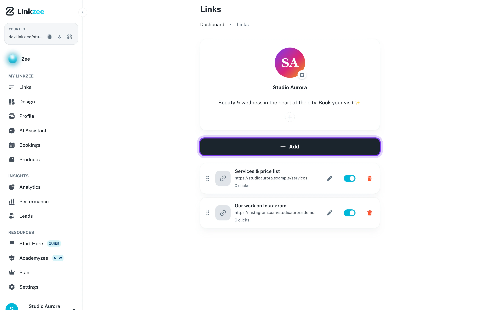
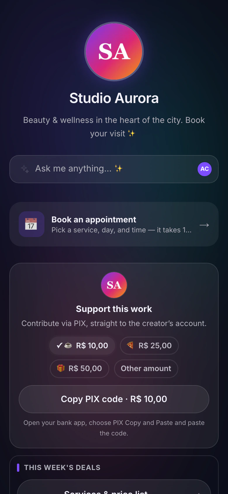

This guide takes you from signing up to a live page at `linkz.ee/your-name`,
ready to drop into your bio. It only takes a few minutes.

<Frame caption="The My Linkzee editor: add links and watch the live preview.">
  
</Frame>

<Steps>
  <Step title="Create your account">
    Sign up with your **email and password**, or choose **Continue with Google**
    for a one-click start with no password to remember. See
    [Create your account](/get-started/create-account) for the details.
  </Step>
  <Step title="Confirm your email">
    If you signed up with email and password, open the activation email from
    Linkzee and click the link to activate your account. If you used
    **Continue with Google**, your account is already active — skip ahead.
  </Step>
  <Step title="Tell us about your work">
    The guided onboarding starts with what you do and how your bio can help
    you. Next, choose how clients reach you. The suggested order of channels
    follows what is common in your country (for example, WhatsApp first in
    Brazil, phone first in Japan, text message first in the US and Canada), and
    you can change the country. Use **Edit text** to change the main button
    label. Links you add get a label by type, and you can rename each button.
    The WhatsApp or phone number you enter here is also saved to your account.
  </Step>
  <Step title="Add your photos">
    Add a **Profile photo**, a **Cover** and up to 3 photos of **Your work**.
    Use **Reframe** to adjust the framing of the profile photo and the cover
    at any time.
  </Step>
  <Step title="Review and publish">
    In step 4, choose your page address in **Your address**. Linkzee checks
    availability as you type and suggests options if the one you want is
    taken. See [Your username](/get-started/your-username) for the rules. A
    ready theme is picked from your logo colors and marked **Your brand**; you
    can choose any other theme. For the work photos, edit the section title
    and, if you like, add a caption to each photo. Open **View full screen** to
    see your bio as visitors will, then tap **Back to edit** or **Publish my bio**.
  </Step>
  <Step title="Share your page and meet your dashboard">
    In step 5 your bio is live at `linkz.ee/your-name`. Copy the link and put it
    in your Instagram or TikTok bio. Then open **Meet your dashboard**: that's
    where you change anything later and follow who arrives through your bio.
    Click **+ Add** to add more items, such as a **Link**, a **Product** or a
    **Social network**.
  </Step>
</Steps>

<Note>
  There's no "Save" button — everything you edit saves automatically, and the
  live preview updates in real time (on the right on desktop; on mobile, tap **Preview** to open
  it full screen).
</Note>

## Where to next

<CardGroup cols={2}>
  <Card title="Your page" icon="table-cells" href="/your-page/overview">
    Build your page: add links, social networks, and your name, photo and bio.
  </Card>
  <Card title="Design & themes" icon="palette" href="/design/overview">
    Pick a ready-made theme and fine-tune colors, buttons and wallpaper.
  </Card>
</CardGroup>

<Frame caption="Your public page, live: bio, scheduling, showcase and assistant in one link.">
  
</Frame>
