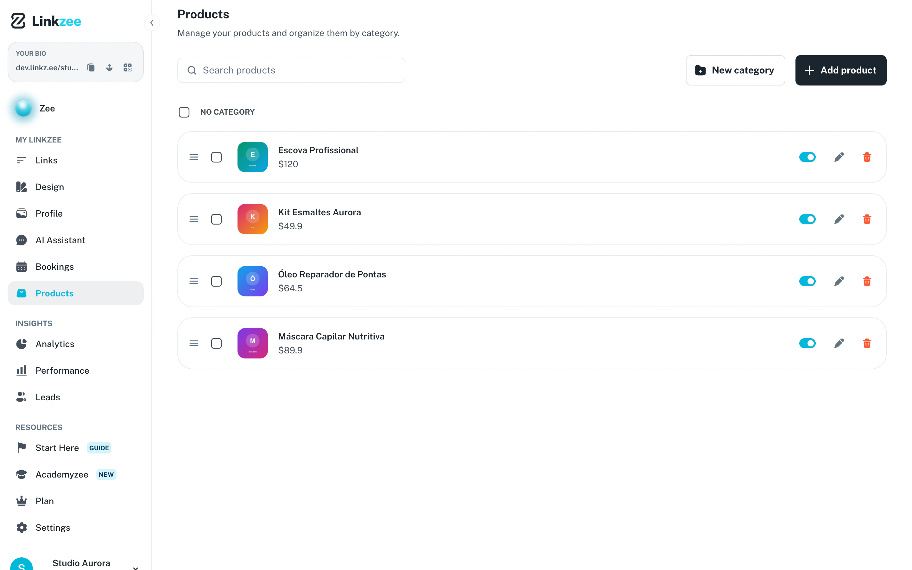

The **product showcase** is Linkzee's edge for affiliates: it turns your
marketplace links into a real shop. Instead of a plain list of links, your
followers see products they can browse and buy in a single tap, while you keep
your affiliate commission.

It works with **Shopee**, **Amazon**, **Mercado Livre** and other marketplaces.

<Frame caption="Your product showcase in the dashboard.">
  
</Frame>

## How it appears on your page

Your products appear **grouped together** as your showcase, so your page stays
clean and easy to browse. How they're laid out is your choice: in **Design**
you can pick the **Standard grid**, **Masonry**, or a **Carousel** that turns
each category into a horizontal shelf with a "See all" button. Each product
card shows:

| Element | What it shows |
| --- | --- |
| **Image** | The product photo |
| **Name** | The product title |
| **Price** | The price in R$, if you set one |
| **Promotion badge** | A short label like "OFFER", when turned on |
| **Scarcity countdown** | A timer that keeps ticking down |
| **Action button** | A button **below** the card that takes visitors to the offer |

When a visitor taps the action button, the click is counted and they're
redirected to the marketplace, keeping your **affiliate link** intact.

<Note>
  Everything you edit saves automatically and updates your live page in real
  time. On desktop the preview sits on the right; on mobile, tap **Preview** in
  the header to see your page full screen.
</Note>

## Explore the showcase

<CardGroup cols={2}>
  <Card title="Adding products" icon="plus" href="/products/adding-products">
    Paste a marketplace link and let Linkzee auto-fill the name, image and price.
  </Card>
  <Card title="Pricing & promotions" icon="tag" href="/products/pricing-promotions">
    Set a price, add a promotion badge, and highlight your best offer.
  </Card>
  <Card title="Scarcity counter" icon="hourglass-half" href="/products/scarcity-counter">
    Add urgency with a countdown that always looks fresh for every visitor.
  </Card>
  <Card title="Categories" icon="layer-group" href="/products/categories">
    Organize a large showcase so visitors can browse by category.
  </Card>
</CardGroup>

## Showcase settings

Open **Showcase settings** from the gear on the showcase card in **Content**,
or go to **Design → Showcase**. Every choice applies right away:

| Setting | Options |
| --- | --- |
| **Grid columns** | **2 columns** or **1 column**. |
| **Grid style** | **Standard**, **Masonry** or **Carousel**. |
| **Card style** | **Classic** or **Spotlight** (see below). |
| **Photos** | **Smart** (recommended) decides per photo: a square photo fills the card, a panoramic one becomes a two-column card and the rest show in full over a soft background. **Always full** never crops the photo and fills the extra space with a blurred version of it. **Fill** crops from the center so every card is filled, ideal for standardized studio photos. |

You can also hide the whole showcase from your page with its switch, without
deleting any product.

## Showcase order

At the top of the **Products** screen, **Showcase order** sets how products line
up on your page:

| Option | How it works |
| --- | --- |
| **Newest first** | The default. New products show up first. |
| **Custom** | The showcase follows your order, and new products go to the top. The first time you pick it, your order starts from the current list. |

Switching back to **Newest first** keeps your custom order saved: pick
**Custom** again and it comes back. The change applies right away, with no
confirmation.

To move a product in the custom order, ask [Zee](/zee/using-zee), for example
"put the gift card at the top", or use the
[API](/api-reference/products#reorder-products). Moving a product while the
showcase is on **Newest first** turns **Custom** on with a new order made
from the list you see, replacing the saved one.

## Spotlight card style

Under **Design → Showcase → Card style** you can switch your product cards from
**Classic** (photo on top, name, price and button below) to **Spotlight**: the
photo fills the card frame, and the name, price and a frosted-glass button sit
right below it, on a soft glow made from the photo's own colors. Text never
covers the product. Badges, like a discount, show as small glass pills at the
foot of the photo. Your page keeps the classic look until you choose it.

With Spotlight on, your showcase also gets:

- **Featured**: a full-width card right where your carousel goes, showing the
  product you marked as featured. With no featured product, your most clicked
  item takes the spot, labelled "most clicked this week".
- **Editorial rhythm**: in the grid, the third card of every five becomes a
  two-column card, like a lookbook.
- **Categories with photos**: the category chips become circles with the
  newest product photo of each category. Once you scroll past them, the chips
  pin under the search bar.
- **Buttons that never wrap**: long button texts are shortened on half-width
  cards to a short verb with the action icon ("Order" + WhatsApp, "View" + ↗);
  the full text shows on featured and wide cards. Tip: first-person copy sells
  better: "I want it", "Want this look", "Get mine" (the product form suggests
  them).
- **Address card**: in the map block, **Display** lets you swap the open map
  for a compact card with your logo, address, today's hours and "Directions".
