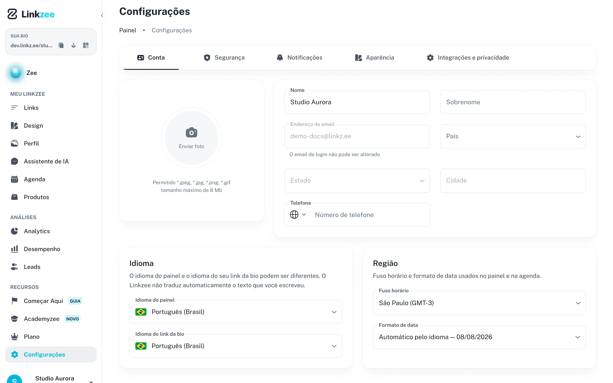

As configurações da sua **conta** ficam em um só lugar. Aqui você define como o
Linkzee fala com você, onde você está e como a interface se parece e se comporta.

<Frame caption="A aba Conta: idioma, região, fuso horário, aparência e acessibilidade.">
  
</Frame>

## Idioma e região

- **Idioma do painel**: o idioma que o Linkzee usa em todo o seu editor.
- **Idioma do link da bio**: o idioma dos botões, rótulos e mensagens da sua
  página pública. Ele pode ser diferente do idioma do painel. O Linkzee não
  traduz o texto que você mesmo escreveu.
- **País** — selecione seu país, e o **fuso horário** o acompanha automaticamente.
- **Estado** e **cidade** — refine sua localização.
- **Formato de data** — escolha como as datas são exibidas.

Tudo isso fica em **Configurações → Idioma e região**. A sua conta e a sua
página começam no idioma da página em que você se cadastrou.

<Note>
  Este fuso horário vale para **o seu painel** (datas, relatórios). Os horários
  dos seus agendamentos seguem o **fuso horário do negócio**, definido à parte em
  **Agenda → Configurações** — assim um negócio pode operar em um fuso diferente
  do da sua conta, e cada um funciona de forma independente.
</Note>

### Sugestão de idioma para a sua página

Se a sua página pública está num idioma que os clientes da sua região não
costumam ler, o painel mostra um aviso curto, por exemplo: "Sua página pública
está em inglês. Os clientes da sua região costumam ler em português." Toque em
**Mudar para** para trocar o idioma da página com um toque, ou em **Manter
como está**.

## Aparência e acessibilidade

- **Aparência** — alterne entre **claro** e **escuro**.
- **Acessibilidade** — ajuste o **tamanho da fonte** e ative o **alto contraste**
  para uma leitura mais fácil.

Toda alteração que você faz aqui tem efeito na hora — não há botão Salvar para
lembrar.

## Páginas relacionadas

<CardGroup cols={2}>
  <Card title="Senha e segurança" icon="lock" href="/pt-BR/account/password-security">
    Altere sua senha ou redefina-a caso tenha esquecido.
  </Card>
  <Card title="SEO da página pública" icon="magnifying-glass" href="/pt-BR/account/public-page-seo">
    Defina o título e a descrição que as pessoas veem no Google e nas prévias de link.
  </Card>
</CardGroup>
