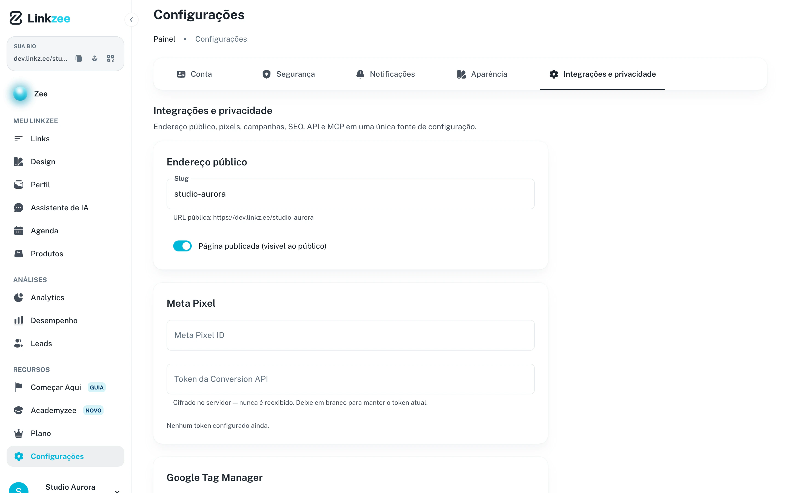

O Linkzee tem sua própria tela de [Desempenho](/pt-BR/analytics/overview), mas você
também pode medir conversões com as **suas** ferramentas de marketing. Conecte-as
uma vez e o Linkzee envia os dados conforme os visitantes interagem com sua página.

<Frame caption="Integrações e privacidade: Meta Pixel, GTM e o endereço público da página.">
  
</Frame>

Tudo aqui é salvo automaticamente enquanto você digita — não existe botão Salvar.

## Meta Pixel

Adicione o ID do seu **Meta Pixel** para acompanhar visitantes e conversões no
Gerenciador de Eventos da Meta. Em seguida, adicione também o token da
**Conversion API**.

O token é importante: navegadores e o iOS frequentemente bloqueiam o script do
pixel, então eventos podem se perder. A Conversion API envia a conversão direto do
Linkzee, então ela continua sendo registrada mesmo quando o script é bloqueado.
Adicionar os dois oferece o rastreamento mais completo.

## Google Tag Manager

Adicione o ID do container do seu **Google Tag Manager** para carregar seu
container do GTM na sua página pública. A partir daí, você pode gerenciar suas
próprias tags e acionadores no Google Tag Manager.

## Parâmetros UTM

Defina parâmetros **UTM** padrão — como origem, mídia e campanha — que o Linkzee
adiciona automaticamente aos seus links de saída. Isso etiqueta o tráfego que você
envia, para que suas análises o atribuam à origem e à campanha corretas.

<Note>
  Você encontra esses valores nas suas ferramentas de marketing — o ID do Pixel e
  o token da Conversion API no **Gerenciador de Eventos da Meta**, e o ID do
  container no **Google Tag Manager**.
</Note>

## Como a Linkzee mede os próprios anúncios

As configurações acima são suas e rodam na sua página pública. À parte, nas
páginas da própria Linkzee (site, quiz, cadastro e assinatura), e só se você
aceitar os cookies de publicidade, a Linkzee mede os resultados dos anúncios
dela com a Meta (Pixel e API de Conversões) e o Google Tag Manager. Para isso, a
Linkzee envia à Meta:

- E-mail, telefone e nome em formato criptografado (hash SHA-256), e um
  identificador interno também em hash.
- Sua localização aproximada derivada do endereço IP (cidade, estado e país,
  nunca o CEP).
- O endereço IP e o navegador usados no momento do evento.
- Os identificadores de anúncio da Meta (cookies `_fbp` e `_fbc`).

Nos pagamentos, o endereço de cobrança informado ao Stripe pode complementar
esses dados. O telefone pode vir da sua conta ou do WhatsApp ou telefone que
você informou ao configurar a sua página.

Esses dados de medição ficam guardados por pouco tempo: o contexto do pagamento
por até **30 dias** e o contexto do cadastro (sem o endereço IP) por até
**90 dias**. Você pode retirar o consentimento a qualquer momento em
**Preferências de cookies**; a retirada apaga esses contextos e interrompe novos
envios. A Linkzee aplica o modo de uso limitado de dados da Meta onde a lei
exige. Se o envio à Meta falhar, o evento fica numa fila de reenvio por até 2
dias, e a Linkzee guarda um registro mínimo das conversões já enviadas (só o
identificador do evento, sem dados pessoais) para nunca contar a mesma conversão
duas vezes. A fila também é apagada quando você retira o consentimento.

## Próximos passos

<CardGroup cols={2}>
  <Card title="Desempenho" icon="chart-line" href="/pt-BR/analytics/overview">
    Veja cliques, visualizações e seus itens de destaque dentro do Linkzee.
  </Card>
  <Card title="Configurações da conta" icon="gear" href="/pt-BR/account/account">
    Defina seu idioma, região, aparência e opções de acessibilidade.
  </Card>
</CardGroup>
