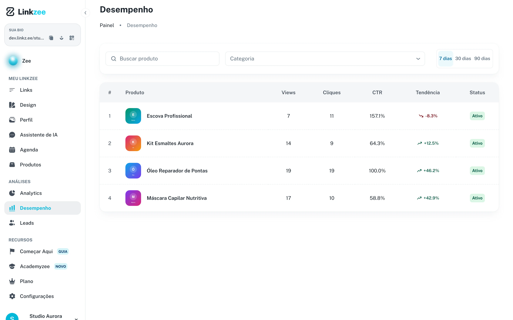

A tela de **Analytics** mostra como está a sua página do Linkzee. Ela acompanha
cada visita desde o momento em que alguém abre a sua página até o clique, o
agendamento ou o contato, para você ver o que funciona e fazer mais disso.

A tela tem três abas — **Resumo**, **De onde vieram** e **Botões** — e um
seletor de período no topo. Abaixo do título você vê quando os números foram
atualizados pela última vez: eles se renovam **mais ou menos a cada hora**.

## Seu histórico por plano

Até onde você consegue olhar para trás depende do plano da loja em que você está:

| Plano | Histórico | Períodos que você pode escolher |
| --- | --- | --- |
| Free | 7 dias | Hoje · 7 dias |
| Essential | 90 dias | Hoje · 7 dias · 30 dias · 90 dias |
| Pro e Scale | 12 meses | Hoje · 7 dias · 30 dias · 90 dias · 12 meses |

Os períodos acima do seu plano aparecem com uma **coroa**. Ao tocar em um deles,
você vê o que cada plano mostra e pode fazer o upgrade. Seus dados continuam
sendo guardados de qualquer forma: ao assinar, o histórico maior aparece na hora.

<Note>
  Todo período termina **hoje** e usa o fuso horário da sua loja. As comparações
  ("vs. 30 dias anteriores") só usam dias dentro do histórico do seu plano, então
  não existe comparação com o ano anterior. **Hoje** e **12 meses** não mostram
  comparação, e você vê "—" sempre que não há histórico suficiente para comparar.
</Note>

## Resumo

A aba **Resumo** mostra o retrato completo em uma tela só:

- **Uma frase de destaque** — por exemplo, *"De cada 100 visitas, 41 clicaram em
  algo e 3 agendaram."* Com menos de 100 visitas, ela usa os números reais.
- **Quatro números principais** — **Visitas**, **Visitantes**, **% que clicou** e
  **Cliques**, cada um com a variação em relação ao período anterior.
- **Visitas e cliques** — um gráfico por dia (por mês em 12 meses).
- **O funil** — o caminho de quem visitou (veja abaixo).
- **De onde vieram** — suas principais origens, com **Ver tudo** para abrir a
  próxima aba.
- **Mais clicados** — seus botões campeões, com **Ver todos** para abrir a aba
  Botões.
- **Dispositivos**, **Cidades** e **Países**.
- Um atalho para **Desempenho dos produtos** (veja [A tela Desempenho](#a-tela-desempenho)).

Se a sua página ainda não teve visitas, a aba mostra **Compartilhar meu link**,
que abre a folha de compartilhar — veja [Links rastreados e QR code](/pt-BR/analytics/tracked-links).

## O funil

O funil mostra quantos visitantes avançaram em cada passo e quantos seguiram de
um passo para o outro. Cada passo só conta pessoas do passo anterior, então um
passo nunca é maior que o anterior.

| Sua página tem… | Funil |
| --- | --- |
| Agenda | Visitaram → Clicaram em algo → Abriram a agenda → Agendaram |
| Captura de contatos, sem agenda | Visitaram → Clicaram em algo → Viraram contato |
| Nenhum dos dois | Visitaram → Clicaram em algo |

## De onde vieram

A aba **De onde vieram** responde *"qual lugar me traz clientes?"*:

- **Por origem** — Instagram, TikTok, WhatsApp, Google, QR impresso e assim por
  diante, com a fatia das visitas, a % que clicou e quantos agendaram em cada uma.
  Abra uma origem para ver de que ponto daquela rede veio a visita — **Bio**,
  **Stories**, **Direct**… — ou **Sem link rastreado** quando a visita chegou sem
  um dos seus links.
- **Direto (sem origem)** — visitas sem informação de onde vieram (a pessoa
  digitou o seu endereço ou o aplicativo escondeu a origem). Quando essa fatia é
  grande, um aviso sugere **Pegar meus links**, para cada rede ganhar o seu
  próprio link.
- **Links de campanha** — as visitas e os agendamentos que cada link de campanha
  trouxe. Toque em um para ver os detalhes. Veja [Links de campanha](/pt-BR/analytics/tracked-links#links-de-campanha).
- **Anúncios e Google Analytics** (avançado) — os parâmetros UTM que chegaram de
  anúncios e ferramentas externas (`utm_source`, `utm_campaign`…).

## Botões

A aba **Botões** ordena todos os botões da sua página, do mais clicado ao menos
clicado: links, produtos, o botão de agendar, redes sociais, o mapa e outros. Use
os filtros do topo (**Todos**, **Links**, **Produtos**, **Agenda**, **Redes
sociais**, **Mapa**) para filtrar.

Toque em um botão para ver os cliques por dia, de onde vieram esses cliques e —
no botão de agendar — quantas pessoas agendaram. **Editar este botão** leva você
direto para onde você o altera.

## O que cada número significa

| Número | O que ele conta |
| --- | --- |
| **Visitas** | Cada vez que alguém abre a sua página. Recarregar ou navegar pela página na mesma visita não conta de novo; uma nova visita começa depois de 30 minutos fora ou quando a pessoa chega por outro link. |
| **Visitantes** | Navegadores ou aparelhos diferentes que abriram a sua página no período. A mesma pessoa no navegador do Instagram e no Safari conta 2. |
| **Cliques** | Toques nos seus links, produtos, botão de agendar, redes sociais, mapa e botões de apoio e de avaliação. |
| **% que clicou** | De todas as visitas, a fatia em que a pessoa clicou em pelo menos uma coisa. |
| **Cliques por visita** ("15 a cada 100 visitas") | Quantos cliques um botão recebeu a cada 100 visitas. Pode passar de 100 quando as pessoas clicam no mesmo botão mais de uma vez. |
| **Abriram a agenda** | Visitas em que a pessoa abriu a sua agenda. |
| **Agendaram** | Agendamentos feitos a partir de uma visita à sua página no período, em qualquer status. |
| **Viraram contato** | Contatos novos capturados a partir de uma visita à sua página no período. |
| **Mais vem de** | A origem que mandou mais cliques para aquele botão. |
| **vs. anterior** | A variação em relação ao período de mesmo tamanho imediatamente antes. Contagens variam em %; taxas variam em pontos ("+3 pontos"). |

<Note>
  O Linkzee mede a sua página com uma **medição própria e anônima**, sem cookies
  de terceiros. Esses dados nunca são compartilhados com ninguém e servem só para
  as estatísticas da sua loja. Visitantes que desligam a medição no aviso de
  cookies continuam contando como visitas, mas não como visitantes.
</Note>

## A tela Desempenho

Ao lado de Analytics no menu existe uma tela dedicada de **Desempenho**: uma
tabela dos seus **produtos**, cada um com suas visualizações, cliques e taxa de
clique no período que você escolher (**7 dias, 30 dias, 90 dias ou 12 meses**,
dentro do histórico do seu plano). Use a tela para descobrir quais produtos
merecem o lugar que ocupam na página — e quais precisam de uma imagem, um título
ou uma posição melhor.

<Frame caption="Desempenho: cliques por link e produto, com totais do período.">
  
</Frame>

## Faça funcionar a seu favor

Use seus números para descobrir de onde vêm os seus clientes e no que eles mais
tocam, e então aposte no que funciona: dê a cada rede o seu próprio link, mova
seus botões mais fortes para o topo e renove ofertas que estão perdendo o gás.

<CardGroup cols={2}>
  <Card title="Links rastreados e QR code" icon="qrcode" href="/pt-BR/analytics/tracked-links">
    Um link para cada lugar onde você divulga a página, links de campanha e uma plaquinha com QR para imprimir.
  </Card>
  <Card title="Aumente seus cliques" icon="arrow-trend-up" href="/pt-BR/best-practices/growing-clicks">
    Dicas práticas para transformar mais visitas em toques.
  </Card>
</CardGroup>
