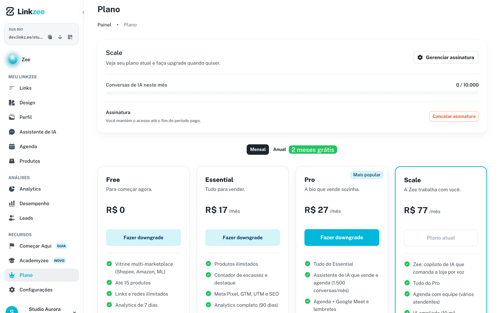

O Linkzee tem quatro planos — **Free, Essential, Pro e Scale** — e a sua primeira
loja começa com **14 dias grátis com tudo liberado**. Esta página explica o que cada
plano inclui, quanto custa em cada país e como funciona a cobrança.

<Note>
  O plano é de uma **loja**, não da sua conta. Se você tem mais de uma loja, cada
  uma carrega o próprio plano, as próprias faturas e a própria data de renovação.
  Veja [Plano por loja](/pt-BR/billing/plan-per-store).
</Note>

<Frame caption="A página Plano: seu plano atual, o uso e todas as opções lado a lado.">
  
</Frame>

## O que cada plano inclui

### Free — para começar
- Vitrine de produtos na Shopee, Amazon BR e Mercado Livre
- Até **15 produtos**
- Links e redes sociais ilimitados
- Analytics de **7 dias**, com link rastreado para cada rede e plaquinha com QR code
- Sua **primeira loja** começa com **14 dias grátis** com todos os recursos (nível Scale), sem cartão

### Essential — tudo para vender
- **Produtos ilimitados**
- Contador de escassez e produtos em destaque
- Meta Pixel, GTM, UTM e SEO
- Analytics de **90 dias**
- **Links de campanha** — até **10** ativos

### Pro — a bio que vende sozinha
Tudo do Essential, e mais:
- **12 meses** de histórico no Analytics
- Links de campanha **ilimitados**
- **Assistente de IA** que vende e agenda — **1.500 conversas/mês** por loja
- Agenda com Google Meet, lembretes por e-mail e **pagamentos no agendamento** (sinal ou valor total — taxa Linkzee de 1% por pagamento neste plano; **0% no Scale**)
- Meta Conversion API (CAPI)
- API pública, MCP e webhook de leads

### Scale — para quem tem equipe
Tudo do Pro, e mais:
- **Agenda com equipe** (vários atendentes; o visitante escolhe com quem agenda)
- IA ampliada — **10 mil conversas/mês** por loja
- **Zee — copiloto de IA por voz** que comanda sua loja por voz e texto (só no Scale)

## Comparação

| Recurso | Free | Essential | Pro | Scale |
| --- | :---: | :---: | :---: | :---: |
| Produtos | 15 | Ilimitado | Ilimitado | Ilimitado |
| Links e redes sociais | Ilimitado | Ilimitado | Ilimitado | Ilimitado |
| Histórico de analytics | 7 dias | 90 dias | 12 meses | 12 meses |
| Contador de escassez e destaque | — | ✓ | ✓ | ✓ |
| Meta Pixel, GTM, UTM, SEO | — | ✓ | ✓ | ✓ |
| Links rastreados por rede + plaquinha com QR | ✓ | ✓ | ✓ | ✓ |
| Links de campanha | — | 10 | Ilimitados | Ilimitados |
| Assistente de IA (vende e agenda) | — | — | 1.500/mês | 10.000/mês |
| Agenda + Google Meet + lembretes por e-mail | — | — | ✓ | ✓ |
| Taxa Linkzee nos pagamentos de agendamento | — | — | 1% | **0%** |
| Meta Conversion API (CAPI) | — | — | ✓ | ✓ |
| API pública + MCP | — | — | ✓ | ✓ |
| Webhook de leads | — | — | ✓ | ✓ |
| Agenda com equipe | — | — | — | ✓ |
| Zee — copiloto de IA (voz e texto) | — | — | — | ✓ |

<Note>
  Cada limite e cada recurso desta tabela são lidos do plano de **uma loja**,
  inclusive a cota de conversas de IA e a taxa Linkzee nos pagamentos de
  agendamento. Uma loja no Free mantém os limites do Free mesmo quando outra
  loja da sua conta está no Scale. O pagamento no agendamento depende da
  agenda, por isso só existe no Pro e no Scale.
</Note>

## Preços

No plano **anual** você ganha **2 meses grátis** (paga 10× o valor mensal).

| Plano | Mensal | Anual (2 meses grátis) |
| --- | --- | --- |
| Free | R$0 / US$0 | R$0 / US$0 |
| Essential | R$27 / US$7 | R$270 / US$70 |
| Pro | R$47 / US$17 | R$470 / US$170 |
| Scale | R$147 / US$47 | R$1.470 / US$470 |

<Note>
  Se você assinou antes de uma mudança de preço, **mantém o valor da sua
  assinatura** enquanto ela estiver ativa **no mesmo plano**. Trocar de plano
  (upgrade ou downgrade) passa a assinatura para o preço em vigor naquele dia.
  Uma loja que você assina depois é cobrada pelo preço em vigor no dia em que
  você a assinou.
</Note>

### Moeda e países

- **Pagando do Brasil:** você é cobrado em reais (**R$**), no valor fixo acima.
- **Qualquer outro país:** o preço tem como base o valor em dólar acima e, no
  checkout, é mostrado e cobrado automaticamente na sua **moeda local** (o valor
  convertido pode variar um pouco conforme o câmbio). Funciona no mundo todo, sem
  uma tabela de preço separada por país.

O país é identificado pelo lugar onde você está quando abre o checkout, e não
pelo seu perfil. Se você estiver viajando ou usando VPN, pode ver o preço em
dólar e sem Pix. Depois de assinar, a assinatura continua nessa moeda.

## 14 dias grátis

Sua **primeira loja** começa no **Free**, mas com **14 dias de teste que liberam
todos os recursos** (o nível Scale) — **sem precisar de cartão**. Aproveite para
testar o assistente de IA, a agenda, o rastreamento e todo o resto. Ao fim dos 14
dias, essa loja permanece no Free, a menos que você assine um plano pago.

Durante o teste, a assistente de IA atende até **1.500 conversas**, o mesmo
limite do Pro.

Durante o teste, a tela **Conteúdo** mostra **Seu teste em números**: os dias
que faltam, uma lista curta de missões para aproveitar ao máximo (publicar 3
produtos, conectar uma rede social, receber o primeiro clique, ativar a
assistente de IA, compartilhar o seu link) e os seus resultados até agora
(visitas na bio, cliques em produtos e o produto campeão).

O teste é **um por pessoa**, não um por loja. Qualquer loja que você criar depois
da primeira começa no **Free, sem teste**, e excluir uma loja não devolve o
teste. Veja [Várias lojas](/pt-BR/account/multiple-stores).

## Trocar de plano

- **Faça upgrade ou downgrade quando quiser** em **Dashboard → Plano**, que
  sempre mostra o plano da **loja em que você está**. Se você tem mais de uma
  loja, troque antes para a loja certa.
- As mudanças entre planos no **mesmo ciclo de cobrança** são
  **proporcionais**. Antes de você confirmar, o Linkzee mostra o **valor
  proporcional exato**.
  - **Upgrade:** você paga só a diferença pelos dias restantes, cobrada na
    hora. O plano novo começa assim que esse pagamento é aprovado. Se ele não
    for aprovado (cartão recusado ou código Pix ainda não pago), o seu **plano
    atual continua ativo** e nada muda.
  - **Downgrade:** o valor não usado vira crédito na sua conta e é descontado
    da próxima fatura. Se você tem mais de uma loja, o crédito pode ser usado
    na próxima fatura de qualquer uma delas.
- Não é possível fazer **upgrade** nas **24 horas antes de uma renovação**,
  qualquer que seja a forma de pagamento. Faça o upgrade depois da renovação.
  O downgrade pode ser feito a qualquer momento.
- **Uma troca por vez.** Enquanto uma troca aguarda pagamento, pague ou deixe
  expirar antes de fazer outra. Com uma renovação pendente, pague a fatura
  antes de trocar de plano.
- **Trocar entre mensal e anual** funciona como uma assinatura nova: cancele a
  atual, deixe o período que você já pagou terminar e só então assine no novo
  ciclo (uma assinatura nova só pode começar quando a atual encerrou de vez).
- **Cancelar** mantém os recursos pagos até o fim do período que você já
  pagou; depois disso **aquela loja** volta para o Free. Suas outras lojas
  mantêm os planos delas.

## Formas de pagamento

No checkout, o Linkzee mostra automaticamente as formas de pagamento
disponíveis no seu país:
- **Brasil:** cartão de crédito e **Pix recorrente** (Pix Automático).
- **Outros países:** cartões internacionais e, conforme o país, outros métodos
  que aceitam cobrança recorrente, como Apple Pay, Klarna, Cash App Pay, Amazon
  Pay ou Satispay.

Todos os pagamentos são processados com segurança pela **Stripe**. O Linkzee é
operado pela **Zee Labs LLC**, uma empresa dos Estados Unidos, e a cobrança no
cartão aparece na sua fatura como **LINKZEE**. No Pix, o app do banco mostra a
**Ebanx**, parceira de Pix da Stripe, como recebedora.

Conforme o país e a forma de pagamento, a Stripe pode pedir o seu endereço de
cobrança no checkout. Ele fica salvo no seu cadastro de pagamento. O checkout
não pede o seu telefone.

### IOF nos pagamentos do Brasil

Como o Linkzee é uma empresa dos Estados Unidos, os pagamentos feitos do Brasil
são compras internacionais e têm **IOF**, o imposto sobre compras
internacionais (hoje, 3,5%):

- **Pix:** o IOF é somado ao preço do plano. Você vê o total no checkout e no
  app do banco antes de confirmar.
- **Cartão:** o seu banco cobra o IOF na fatura do cartão, como em qualquer
  compra internacional.

### Pagando com Pix recorrente

Quando você assina com Pix, autoriza o **Pix Automático** no app do seu banco
uma única vez. Depois disso, cada renovação é debitada automaticamente: o seu
banco avisa o valor com antecedência, e o débito normalmente acontece cerca de
**3 dias depois da data de renovação**. Não há nada para pagar à mão.

- **Plano anual:** o checkout mostra o limite anual que você está autorizando.
  O limite fica um pouco acima do preço do plano, como margem de segurança,
  mas você só é cobrado pelo preço do seu plano, mais o IOF (veja acima).
- **Upgrade com Pix:** a diferença proporcional não entra no débito
  automático, então você paga uma vez com um código Pix (ou cartão). Até você
  pagar, o seu **plano atual continua ativo** e nada é cobrado. Se o código
  expirar, abra a fatura de novo e um código novo é gerado. Se a diferença não
  for paga em cerca de um dia, a troca é cancelada e o seu plano continua o
  mesmo.
- Para fazer upgrade de um **plano anual pago com Pix**, fale com o suporte.
- Se a autorização do Pix Automático for pausada ou cancelada no app do banco,
  ou se o banco não agendar uma renovação, você recebe um e-mail para pagar a
  renovação antes que algo seja interrompido.

## Quando um pagamento fica pendente

Se uma renovação não é paga, no cartão ou no Pix, o Linkzee normalmente
**mantém o seu plano ativo por mais alguns dias** para você pagar.
**Dashboard → Plano** mostra **Pagamento pendente**, com a data até a qual o
seu plano continua ativo, e um botão **Pagar agora** que abre a fatura em
aberto (Pix ou cartão). A fatura também aparece com **Pagar** no histórico de
pagamentos.

Se um pagamento dessa assinatura já falhou há pouco tempo, esse prazo extra
pode não ser dado de novo, e a loja volta para o Free na hora, até a fatura
ser paga.

Se a fatura continuar sem pagamento nessa data, os recursos pagos daquela loja
são pausados e ela volta para o Free. **Nada é apagado** (os produtos acima do
limite do Free só ficam ocultos): assim que a fatura é paga, tudo volta de onde
você parou. O Linkzee avisa você por e-mail antes e no momento em que isso
acontece.

## Faturas e recibos

Toda cobrança gera uma fatura que você pode baixar como **recibo em PDF**:

1. Troque para a loja cujas faturas você quer ver.
2. Acesse **Dashboard → Plano**.
3. Abra o **Histórico de pagamentos**.
4. Cada item mostra o valor, a data e o status — clique em **Recibo** para abrir ou baixar o PDF.

Cada loja tem o próprio histórico de pagamentos, então as faturas de uma loja só
aparecem enquanto ela é a loja ativa.

<Note>
Não sabe qual plano combina com você? Escreva para support@linkz.ee que a gente te ajuda a escolher.
</Note>
