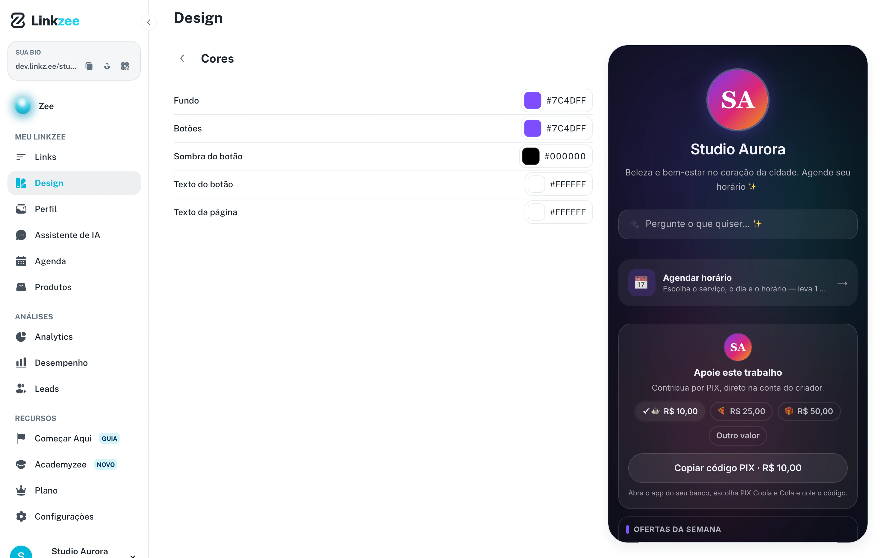

Um tema entrega um visual completo com um toque. Quando você quer ir além, o
Linkzee oferece controles **curados** para ajustar os detalhes. Você escolhe
entre opções feitas para funcionar juntas, então nada nunca destoa.

<Frame caption="O painel Cores: espectro completo, hex e sugestões — com preview instantâneo.">
  
</Frame>

Cada mudança aparece na hora no preview — à direita no desktop, ou embaixo do
editor no celular — e é salva automaticamente conforme você edita.

## O que você pode ajustar

<AccordionGroup>
  <Accordion title="Topo" icon="user">
    Escolha como seu nome, foto e logo ficam no topo da sua página:
    - **Clássico**: um avatar redondo e compacto com seu nome e bio.
    - **Hero**: uma foto **ou um vídeo curto** que sangra no topo da página
      (veja [Perfil](/pt-BR/your-page/header)).
    - **Banner**: uma imagem de capa com seu avatar sobreposto.
    - **Recorte**: você, sem fundo, em pé sobre a sua página. Envie um **PNG
      ou WebP transparente**; imagem sem transparência não é aceita neste
      layout.
    - **Forma**: seu retrato dentro de um contorno orgânico. Escolha
      **Orgânico**, **Orgânico 2**, **Arco** ou **Quadrado suave**, e uma cor
      para a forma (ou deixe na cor do tema).

    **Ajustar enquadramento** permite arrastar e dar zoom na foto dentro do
    layout. Com um vídeo na hero, você também pode colocar seu logo por cima
    dele, sólido ou vidro (Premium), com uma borda na cor do seu avatar.
  </Accordion>
  <Accordion title="Avatar" icon="circle-user">
    Escolha como sua foto aparece no topo da página: **Nenhum**, **Anel**,
    **Anel colorido**, **Sombra** ou **Brilho**, com a **Cor do avatar** que
    você quiser. Enquanto você não escolhe, vale o efeito do tema. O layout
    Hero mostra a foto de ponta a ponta, então não tem efeito de avatar.
  </Accordion>
  <Accordion title="Papel de parede" icon="image">
    Defina o estilo do fundo. Cada estilo mostra uma amostra real, e as opções
    dele aparecem logo abaixo. A cor principal vem de **Cores**; os estilos que
    misturam duas cores ganham o campo **Segunda cor**.

    | Estilo | Opções |
    | --- | --- |
    | **Cor sólida** | Só a cor. |
    | **Gradiente** | **Personalizado** (duas cores, direção **Para cima**, **Para baixo** ou **Radial**) ou **Pré-fabricado** (15 gradientes prontos, como Pôr do sol, Oceano e Meia-noite, com cores de texto que ficam legíveis sobre eles). **Animar** faz o gradiente se mover suavemente; **Textura granulada** adiciona um granulado sutil. |
    | **Blur** | Manchas de cor suaves, com **Intensidade** e **Posição** (topo, centro ou difuso). |
    | **Padrão** | 10 padrões (pontos, grade, ondas, colmeia e outros) tingidos com a sua cor, com **Tamanho** e **Intensidade**. |
    | **Malha** | Campos de cor mesclados em três disposições: **Clássica**, **Cantos** ou **Centro**. |
    | **Imagem** | Sua própria foto, com **Escurecer a foto** (leve, médio, forte) para manter o texto legível e um **Desfoque** opcional. Você pode reenquadrá-la. |
    | **Duotone** | Sua foto em duas cores: a sua cor principal e uma **Segunda cor**. |
    | **Vídeo** | Um clipe curto em loop. |

    **Vídeo** aceita um arquivo MP4 ou MOV de até 40 MB e o otimiza do mesmo
    jeito que o vídeo da hero (720p, os primeiros 30 segundos, sem som e em
    loop) para carregar rápido. Você pode **Trocar** ou **Remover** quando
    quiser. Visitantes que preferem menos animação ou estão com economia de
    dados veem a imagem de capa no lugar.
  </Accordion>
  <Accordion title="Layout da vitrine de produtos" icon="grip">
    Escolha como a sua vitrine de produtos é exibida: **Padrão**, uma grade
    limpa; **Mosaico (masonry)**, cards de alturas variadas; ou **Carrossel**,
    em que cada categoria vira uma prateleira horizontal com deslize no celular
    (setas no computador) e um botão **"Ver tudo (n)"** que expande a
    categoria inteira ali mesmo. Você também define o estilo do card e como as
    fotos se encaixam (veja
    [Vitrine de produtos](/pt-BR/products/overview)).
  </Accordion>
  <Accordion title="Botões" icon="square">
    Defina o **Estilo** do botão (preenchido, contorno, suave ou **vidro**), o
    **Formato** do botão (arredondado, levemente arredondado ou reto) e a
    **Sombra** do botão (nenhum, macio, forte ou duro). A sombra é totalmente
    livre, para você chegar exatamente na profundidade que quer.
  </Accordion>
  <Accordion title="Texto" icon="font">
    Escolha sua **fonte** em uma lista curada, agrupada em sem serifa, com
    serifa e mono e display. Ou abra **Pares** para combinações prontas: uma
    fonte para o nome e os títulos, outra para os textos, em estilos como
    Editorial, Moderno, Boutique ou Divertido.
  </Accordion>
  <Accordion title="Cores" icon="palette">
    Defina a cor do **fundo**, dos **botões**, da **sombra do botão**, do
    **texto do botão** e do **texto da página**. Cada linha abre um **seletor de
    cor completo** (espectro, código hex, conta-gotas e amostras sugeridas)
    para você acertar a cor exata da sua marca, não só as prontas.

    Se uma combinação fica difícil de ler, aparece o aviso **Contraste baixo
    para leitura** com uma sugestão, para a sua página continuar legível.
  </Accordion>
  <Accordion title="Ícones sociais" icon="share-nodes">
    Escolha a aparência dos seus ícones sociais: **Padrão** (segue o tema),
    **Ícones**, **Preenchido**, **Contornado** ou **Botões**. Preenchido e
    Contornado usam a cor do botão; Botões mostram o nome de cada rede.
  </Accordion>
  <Accordion title="Cartões" icon="clone">
    Defina o visual dos cartões da sua página: **Sólido**, **Vidro**, **Neon**
    ou **Suave**, com **Cantos** sutis, médios ou redondos.
  </Accordion>
  <Accordion title="Movimento" icon="wand-magic-sparkles">
    Defina a **intensidade das animações** da sua página pública:
    **Desligado**, **Sutil** ou **Padrão**. Visitantes com preferência de menos
    movimento sempre veem a versão estática. Aqui também fica o **Modo Palco**
    (Premium), que faz a sua página reagir à música do seu card do Spotify
    (veja [Spotify](/pt-BR/your-page/spotify)).
  </Accordion>
</AccordionGroup>

<Note>
  As amostras sugeridas e as fontes prontas são grátis. Os recursos premium
  aparecem com um selo e você pode testá-los em qualquer plano: uma **cor
  personalizada** (fora das amostras sugeridas), o estilo de botão **vidro**,
  os papéis de parede **Imagem**, **Malha**, **Duotone** e **Vídeo**, os
  gradientes **radial** e **pré-fabricado**, **Animar**, um **vídeo na hero**,
  o logo de vidro sobre o vídeo e as fontes e pares premium. Você vê tudo no
  preview ao vivo, mas, se **esta loja** está no Free, a página **pública**
  dela mantém o último visual grátis até você assinar um plano para essa loja
  (veja [Plano por loja](/pt-BR/billing/plan-per-store)).
</Note>

### Salvar ou descartar mudanças premium

No plano Free, assim que você aplica uma opção premium, o salvamento
automático pausa e os botões **Salvar** e **Descartar** aparecem no topo da
tela de Design.

- **Descartar** traz de volta o visual que está publicado.
- **Salvar** abre as opções de upgrade. Quando a loja estiver num plano pago,
  tudo o que você definiu é publicado.

As opções grátis continuam salvando automaticamente, como sempre.

<Warning>
  Escolher um tema pronto de novo reverte essas escolhas para o visual daquele tema.
</Warning>

## Próximos passos

<CardGroup cols={2}>
  <Card title="Temas" icon="swatchbook" href="/pt-BR/design/themes">
    Comece de um visual completo e pronto, depois ajuste os detalhes aqui.
  </Card>
  <Card title="Visão geral do Design" icon="palette" href="/pt-BR/design/overview">
    Veja como os temas e a customização funcionam juntos.
  </Card>
</CardGroup>
