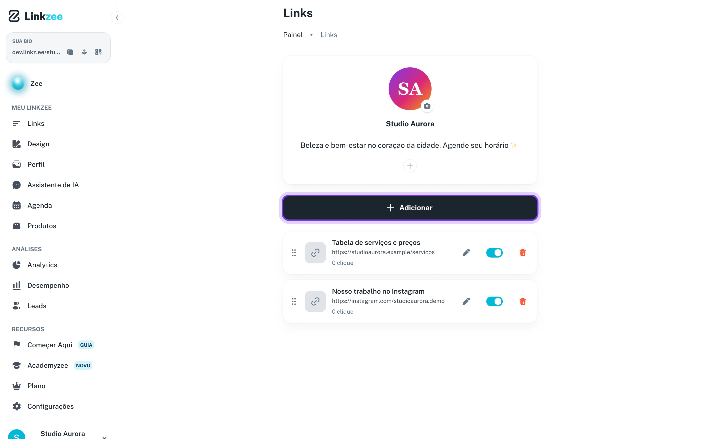
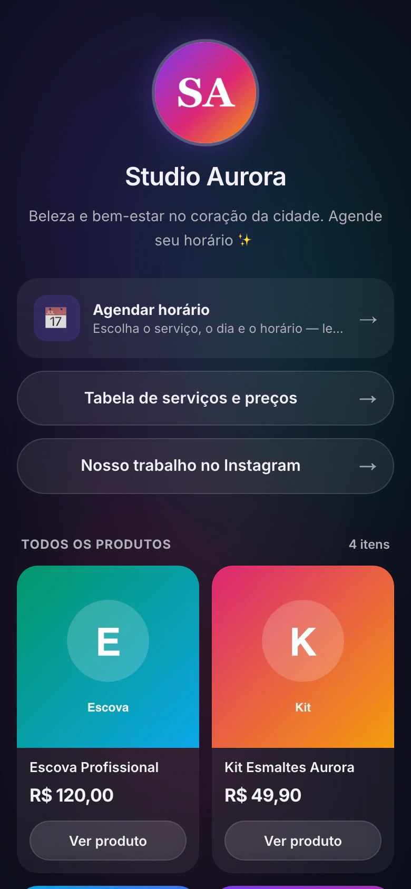

Este guia leva você do cadastro até uma página no ar em `linkz.ee/your-name`,
pronta para colocar na sua bio. Leva só alguns minutos.

<Frame caption="O editor Meu Linkzee: adicione links e veja o preview em tempo real.">
  
</Frame>

<Steps>
  <Step title="Crie sua conta">
    Cadastre-se com **e-mail e senha** ou escolha **Continuar com Google**
    para começar com um clique, sem senha para decorar. Veja
    [Crie sua conta](/pt-BR/get-started/create-account) para os detalhes.
  </Step>
  <Step title="Confirme seu e-mail">
    Se você se cadastrou com e-mail e senha, abra o e-mail de ativação da
    Linkzee e clique no link para ativar sua conta. Se você usou
    **Continuar com Google**, sua conta já está ativa — pode pular esta etapa.
  </Step>
  <Step title="Conte sobre o seu trabalho">
    O onboarding guiado começa pela sua área de atuação e por como a bio pode
    ajudar você. Depois, escolha como seus clientes falam com você. A ordem
    sugerida dos canais segue o costume do seu país (por exemplo, WhatsApp
    primeiro no Brasil, telefone primeiro no Japão, mensagem de texto primeiro
    nos EUA e no Canadá), e você pode trocar o país. Use **Trocar texto** para
    mudar o texto do botão principal. Os links que você adiciona ganham um nome
    pelo tipo, e você pode renomear cada botão. O WhatsApp ou telefone que você
    informa aqui também fica guardado na sua conta.
  </Step>
  <Step title="Adicione suas fotos">
    Envie a **Foto de perfil**, a **Capa** e até 3 fotos do **Seu trabalho**.
    Use **Reenquadrar** para ajustar o enquadramento da foto de perfil e da capa
    quando quiser.
  </Step>
  <Step title="Revise e publique">
    No passo 4, escolha o endereço da sua página em **Seu endereço**. O Linkzee
    confere a disponibilidade enquanto você digita e sugere opções se o que você
    quer já tiver dono. Veja [Seu nome de usuário](/pt-BR/get-started/your-username)
    para as regras. Um tema pronto é escolhido pelas cores da sua logo e aparece
    com o selo **Sua marca**; você pode escolher qualquer outro tema. Nas fotos
    do trabalho, edite o título da seção e, se quiser, coloque uma legenda em
    cada foto. Abra **Ver em tela cheia** para ver a bio como o visitante vê e
    depois toque em **Voltar e ajustar** ou **Publicar minha bio**.
  </Step>
  <Step title="Compartilhe sua página e conheça o painel">
    No passo 5 sua bio já está no ar em `linkz.ee/your-name`. Copie o link e
    coloque na bio do Instagram ou do TikTok. Depois abra **Conheça o seu
    painel**: é lá que você muda tudo quando quiser e acompanha quem chega pela
    sua bio. Clique em **+ Adicionar** para incluir mais itens, como um **Link**,
    um **Produto** ou uma **Rede social**.
  </Step>
</Steps>

<Note>
  Não existe botão "Salvar" — tudo o que você edita é salvo automaticamente, e a
  pré-visualização ao vivo atualiza em tempo real (à direita no desktop, embaixo do editor no
  mobile).
</Note>

## Para onde ir agora

<CardGroup cols={2}>
  <Card title="Sua página" icon="table-cells" href="/pt-BR/your-page/overview">
    Monte sua página: adicione links, redes sociais e seu nome, foto e bio.
  </Card>
  <Card title="Design e temas" icon="palette" href="/pt-BR/design/overview">
    Escolha um tema pronto e ajuste cores, botões e papel de parede.
  </Card>
</CardGroup>

<Frame caption="Sua página pública pronta: bio, agenda, vitrine e assistente num só link.">
  
</Frame>
