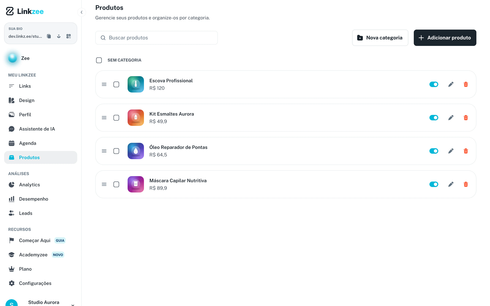

A **vitrine de produtos** é o diferencial da Linkzee para afiliados: ela
transforma seus links de marketplace em uma loja de verdade. Em vez de uma
lista simples de links, seus seguidores veem produtos que podem explorar e
comprar em um único toque, enquanto você mantém sua comissão de afiliado.

Funciona com **Shopee**, **Amazon**, **Mercado Livre** e outros marketplaces.

<Frame caption="Sua vitrine de produtos no painel.">
  
</Frame>

## Como ela aparece na sua página

Seus produtos aparecem **agrupados juntos** como a sua vitrine, para que sua
página fique organizada e fácil de navegar. O layout é escolha sua: em
**Design** você escolhe entre a **grade padrão**, o **mosaico (masonry)** ou o
**carrossel**, que transforma cada categoria em uma prateleira horizontal com
botão "Ver tudo". Cada card de produto mostra:

| Elemento | O que mostra |
| --- | --- |
| **Imagem** | A foto do produto |
| **Nome** | O título do produto |
| **Preço** | O preço em R$, se você definir um |
| **Selo de promoção** | Um texto curto como "OFERTA", quando ativado |
| **Contador de escassez** | Um cronômetro que continua em contagem regressiva |
| **Botão de ação** | Um botão **abaixo** do card que leva os visitantes até a oferta |

Quando um visitante toca no botão de ação, o clique é contabilizado e ele é
redirecionado para o marketplace, mantendo seu **link de afiliado** intacto.

<Note>
  Tudo o que você edita é salvo automaticamente e atualiza sua página no ar em
  tempo real. No desktop o preview fica à direita; no celular, toque em
  **Preview** no topo para ver a sua página em tela cheia.
</Note>

## Explore a vitrine

<CardGroup cols={2}>
  <Card title="Adicionar produtos" icon="plus" href="/pt-BR/products/adding-products">
    Cole um link de marketplace e deixe a Linkzee preencher automaticamente o nome, a imagem e o preço.
  </Card>
  <Card title="Preços e promoções" icon="tag" href="/pt-BR/products/pricing-promotions">
    Defina um preço, adicione um selo de promoção e destaque sua melhor oferta.
  </Card>
  <Card title="Contador de escassez" icon="hourglass-half" href="/pt-BR/products/scarcity-counter">
    Crie urgência com uma contagem regressiva que parece sempre atual para cada visitante.
  </Card>
  <Card title="Categorias" icon="layer-group" href="/pt-BR/products/categories">
    Organize uma vitrine grande para que os visitantes possam navegar por categoria.
  </Card>
</CardGroup>

## Configurações da vitrine

Abra as **Configurações da vitrine** pela engrenagem no card da vitrine em
**Conteúdo**, ou vá em **Design → Vitrine**. Cada escolha vale na hora:

| Configuração | Opções |
| --- | --- |
| **Colunas do grid** | **2 colunas** ou **1 coluna**. |
| **Estilo do grid** | **Padrão**, **Masonry** ou **Carrossel**. |
| **Estilo do card** | **Clássico** ou **Spotlight** (veja abaixo). |
| **Fotos** | **Inteligente** (recomendado) decide por foto: a quadrada preenche o card, a panorâmica vira um card de duas colunas e as demais aparecem inteiras sobre um fundo suave. **Sempre inteira** nunca corta a foto e preenche a sobra com uma versão desfocada dela. **Preencher** corta pelo centro para todo card ficar cheio, ideal para fotos padronizadas de estúdio. |

Você também pode ocultar a vitrine inteira da sua página pela chave dela, sem
apagar nenhum produto.

## Ordem da vitrine

No topo da tela **Produtos**, a **Ordem da vitrine** define como os produtos se
organizam na sua página:

| Opção | Como funciona |
| --- | --- |
| **Mais recentes** | O padrão. Os produtos novos aparecem primeiro. |
| **Personalizada** | A vitrine segue a sua ordem, e os produtos novos entram no topo. Na primeira vez que você escolhe, a ordem parte da lista atual. |

Voltar para **Mais recentes** mantém a sua ordem personalizada guardada: escolha
**Personalizada** de novo e ela volta. A troca vale na hora, sem confirmação.

Na tela **Vitrine** do menu, arraste os cards para mudar a ordem. A nova ordem
salva sozinha e liga a **Personalizada**.

Você também pode mover um produto pedindo à [Zee](/pt-BR/zee/using-zee),
por exemplo "coloca o vale-presente no topo", ou use a
[API](/pt-BR/api-reference/products#reordenar-produtos). Mover um produto com a
vitrine em **Mais recentes** liga a **Personalizada** com uma ordem nova, feita a
partir da lista que você vê, no lugar da que estava guardada.

## Estilo de card Spotlight

Em **Design → Vitrine → Estilo do card** você troca os cards de produto de
**Clássico** (foto em cima; nome, preço e botão embaixo) para **Spotlight**: a
foto preenche a moldura do card, e nome, preço e um botão de vidro ficam logo
abaixo dela, sobre um brilho suave feito com as cores da própria foto. O texto
nunca cobre o produto. Selos, como o de desconto, aparecem como pequenas
pílulas de vidro no pé da foto. Sua página continua no clássico até você
escolher.

Com o Spotlight ligado, a vitrine ganha também:

- **Em destaque**: um card de largura total, na posição do carrossel, com o
  produto que você marcou como destaque. Sem destaque, o produto mais clicado
  assume o lugar, rotulado "o mais clicado da semana".
- **Ritmo editorial**: na grade, o terceiro card de cada cinco vira um card
  de duas colunas, como um lookbook.
- **Categorias com foto**: os chips de categoria viram círculos com a foto do
  produto mais recente de cada uma. Ao rolar além deles, os chips se fixam
  abaixo da busca.
- **Botões que nunca quebram linha**: textos longos de botão viram, nos cards
  de meia largura, um verbo curto com o ícone da ação ("Pedir" + WhatsApp,
  "Ver" + ↗); o texto completo aparece no destaque e nos cards largos. Dica:
  copy em primeira pessoa vende mais: "Quero", "Quero esse look", "Garantir o
  meu" (o formulário do produto sugere).
- **Cartão de endereço**: no bloco do mapa, a opção **Exibição** troca o mapa
  aberto por um cartão compacto com logo, endereço, horário de hoje e "Como
  chegar".
