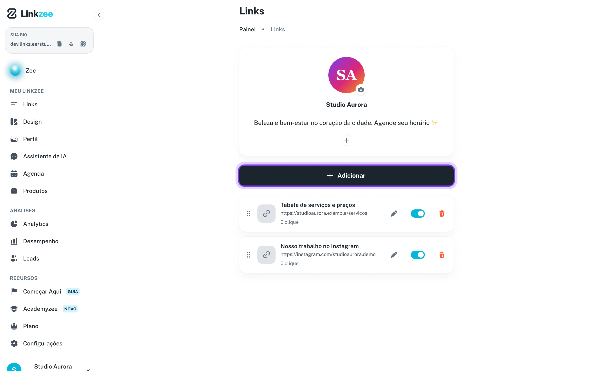
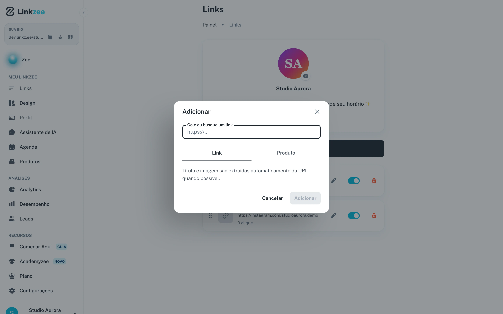

Os links são o coração da sua página Linkzee. Adicione qualquer URL que você queira
compartilhar — um post de blog, um cupom, um vídeo do YouTube, sua loja — e ele
aparece na sua página na hora.

<Frame caption="Meu Linkzee: seu topo, o botão Adicionar e todos os links numa lista só.">
  
</Frame>

## Adicionar um link

<Steps>
  <Step title="Abra a tela de conteúdo">
    É aqui que você monta a sua página.
  </Step>
  <Step title="Clique em + Adicionar">
    Use o botão **+ Adicionar** de largura total e depois escolha **Link**.
  </Step>
  <Step title="Preencha os detalhes">
    Digite um **título** e cole a **URL**. Pronto — o link aparece na sua
    página na mesma hora.
  </Step>
</Steps>

<Frame caption="O modal Adicionar: Link, Produto, Rede social ou Apoio — tudo nasce daqui.">
  
</Frame>

<Note>
  Tudo é salvo automaticamente enquanto você digita — não existe botão **Salvar**.
  A sua prévia ao vivo é atualizada em tempo real, à direita no desktop e abaixo
  do editor no celular.
</Note>

## Links de WhatsApp

Quer um link que abre uma **conversa no WhatsApp** com você? Ao adicionar um
link, escolha o destino **WhatsApp**: informe seu número e uma mensagem
pré-preenchida opcional, e o Linkzee monta o link `wa.me` correto sozinho —
sem montar URL na mão. Funciona nos botões de produto também.

## Adicione mídia a um link

Um link pode ser mais do que texto — dê a ele um card visual:

| Mídia | O que faz |
| --- | --- |
| **Imagem** | Uma foto ou miniatura exibida no card; os visitantes podem tocar para vê-la em tela cheia. |
| **Vídeo** | Um clipe curto (até **60 segundos / 40 MB**) que toca direto na sua página. |
| **Embed** | Cole uma URL do **YouTube ou Vimeo** e o player fica incorporado no card. |

Abra qualquer link e escolha o tipo de mídia no editor do link. Para incorporar
um vídeo, escolha a opção **Embed** e cole ali a URL do YouTube ou do Vimeo.

## Blocos Antes & Depois e Galeria

Além de links com mídia, sua página pode mostrar **blocos de fotos** — cards
cujo conteúdo são as próprias fotos, sem URL de destino (recurso Premium):

| Bloco | O que faz |
| --- | --- |
| **Antes & Depois** | Duas fotos sobrepostas com uma **aresta deslizante**: o visitante arrasta para comparar o resultado. Você pode renomear os rótulos "Antes"/"Depois" e escolher onde a aresta começa. |
| **Galeria** | **De 2 a 10 fotos** que o visitante desliza, com pontinhos e contador. |

<Steps>
  <Step title="Clique em + Adicionar e escolha Antes & Depois ou Galeria">
    Cada bloco tem o seu próprio editor. Blocos de fotos não entram dentro de coleções.
  </Step>
  <Step title="Adicione as fotos">
    O Antes & Depois usa exatamente duas fotos (antes à esquerda, depois à
    direita). Na galeria, adicione de 2 a 10 fotos — no computador, arraste os
    arquivos direto da pasta para a área das fotos — e arraste as miniaturas para
    reordenar. Precisa ajustar uma foto? **Reenquadrar** deixa arrastar e dar
    zoom dentro do quadro, igual à foto do perfil — o que você vê é o que publica. Use fotos com o mesmo enquadramento — **4:5 (retrato)** funciona
    melhor; fotos com proporções diferentes são recortadas nas bordas.
  </Step>
  <Step title="Confirme que tem autorização">
    Fotos de clientes são dados pessoais. Marque a caixa confirmando que as
    pessoas fotografadas autorizaram a publicação — é obrigatório uma vez por
    bloco, e a data da sua confirmação fica registrada.
  </Step>
  <Step title="Salve">
    A pré-visualização dentro do editor mostra o bloco real antes de salvar. As
    fotos sobem quando você clica em **Salvar**; um bloco com fotos faltando
    fica oculto da página até estar completo.
  </Step>
</Steps>

<Note>
  Blocos de fotos são **Premium**. No plano gratuito você monta e pré-visualiza,
  mas salvar pede o upgrade. A legenda opcional aparece sobre as fotos; o nome
  do bloco é interno (ajuda você e a Zee a encontrá-lo). Blocos de fotos não
  recebem o efeito de destaque animado — as fotos são o foco.
</Note>

### Transforme em uma seção de Resultados

Um bloco **Antes & Depois** pode virar uma seção de **Resultados** completa,
com cara de vitrine:

- **Título da seção:** é o **nome do bloco** (ex.: "Resultados").
- **Legenda e subtítulo** aparecem sobre a foto, num degradê escuro na parte de
  baixo (ex.: "Prótese capilar" · "Resultado no mesmo dia").
- **Botão "Quero esse":** escolha um serviço da sua Agenda no campo **Botão
  "Quero esse"** e o cliente vai direto ao agendamento daquele serviço, sem
  escolher de novo. O botão só aparece com o serviço ativo e a Agenda no seu
  plano.
- **Galeria em miniaturas:** numa Galeria, escolha **Exibição → Miniaturas**.
  Colocada logo abaixo do Antes & Depois na lista, ela entra na mesma seção:
  3 miniaturas e **Galeria (N)**, que abre todas as fotos em tela cheia (com o
  botão "Quero esse", se houver serviço vinculado).

Um Antes & Depois sem subtítulo, serviço ou galeria em miniaturas continua
aparecendo como sempre.

### Vitrine vertical

Uma **Galeria** também pode virar uma **Vitrine vertical**: cartões altos de
fotos e vídeos, lado a lado, como nos stories. Ela foi feita para portfólios,
looks e trabalhos prontos (por exemplo, "Nossos trabalhos").

<Steps>
  <Step title="Escolha o layout">
    No editor da galeria, defina **Exibição → Vitrine vertical**. O nome do
    bloco vira o título da seção na sua página (por exemplo, "Portfólio").
  </Step>
  <Step title="Adicione fotos e vídeos">
    Adicione de **2 a 10 itens** em formato vertical (**9:16**). Fotos vão até
    8 MB cada; vídeos **MP4 ou MOV**, até 40 MB. Os vídeos são otimizados
    automaticamente para carregar rápido e ficam com os primeiros **30
    segundos**. Enquanto um vídeo é otimizado, ele mostra **Otimizando…** e
    aparece na sua página assim que fica pronto.
  </Step>
  <Step title="Dê um nome a cada item">
    O nome aparece no cartão (até 40 caracteres).
  </Step>
  <Step title="Escolha o que o toque faz">
    Cada item tem uma **Ação ao tocar**: **Serviços** (um botão "Quero esse"
    que leva direto ao agendamento daquele serviço), **Produtos** (um botão
    "Quero esse" que abre o produto), **Pedir pelo WhatsApp**, **Sem botão**
    ou **Padrão do bloco**. A **Ação padrão das fotos** vale para todo item
    sem serviço ou produto próprio.
  </Step>
</Steps>

Na sua página, o visitante toca num cartão para abrir em tela cheia e depois
toca nas bordas ou desliza para ver o próximo. Os vídeos começam sem som, e o
visitante pode ligar o som ou pausar. **Ver todos (N)** abre todos os itens.

**Pedir pelo WhatsApp** abre uma conversa com o número da sua loja, com uma
mensagem pronta citando o item e um link para aquela foto. O link mostra uma
prévia da foto quando é enviado, então você sabe exatamente qual peça o
cliente quer. Para usar, cadastre o número de WhatsApp da loja em **Redes**.

<Note>
  Com vídeos, a galeria fica no layout de vitrine vertical. Remova os vídeos
  para trocar de layout. A caixa de permissão também cobre a voz das pessoas
  nos vídeos e, no caso de menores, o consentimento dos pais ou responsáveis.
</Note>

## Destaque animado

Quer que um link chame a atenção? O editor do link tem um efeito de **destaque
animado** que atrai o olhar para aquele card na sua página pública — o mesmo
efeito está disponível nos produtos. É um **recurso premium**: salvar um link
com o efeito exige que **esta loja** esteja em um plano pago. Se a loja que você
está editando está no Free, o editor abre o convite para fazer upgrade (veja
[Planos e preços](/pt-BR/billing/plans) e
[Plano por loja](/pt-BR/billing/plan-per-store)).

## Gerencie seus links

Cada link tem alguns controles para você deixar a sua página exatamente do jeito que quiser.

| Controle | O que faz |
| --- | --- |
| Lápis | Edite o título ali mesmo, no lugar onde ele está. |
| Interruptor liga/desliga | Mostre ou oculte o link sem excluí-lo. |
| Contador de cliques | Veja quantas vezes os visitantes tocaram no link. |
| Alça de arrastar | Reordene os links arrastando-os para cima ou para baixo. |
| Excluir | Remova o link — antes você será solicitado a confirmar. |

A reordenação acontece ao vivo: arraste um link e a prévia acompanha, depois a nova
ordem é salva sozinha.

## Agrupe links em coleções

Quando você tem muitos links, agrupe-os em **coleções** para criar seções
identificadas na sua página — como "Meus cursos" ou "Cupons de desconto". Isso
mantém a sua página organizada e fácil de percorrer.

<CardGroup cols={2}>
  <Card title="Coleções" icon="folder" href="/pt-BR/your-page/collections">
    Agrupe seus links em seções identificadas na sua página.
  </Card>
  <Card title="Sua página" icon="table-cells" href="/pt-BR/your-page/overview">
    Monte e organize tudo na sua tela de conteúdo.
  </Card>
</CardGroup>
