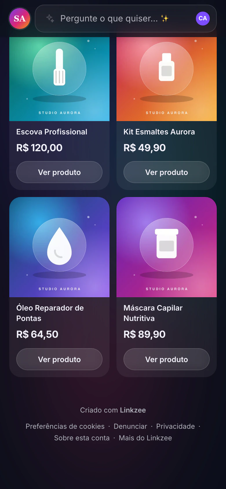

Sua página nasceu para ser divulgada. O Linkzee te dá um **QR code** para
baixar, uma **imagem de preview** caprichada para os apps — e, se quiser, um
**card de apoio via PIX** para os visitantes mandarem uma contribuição direta.

## QR code

Toque em **Compartilhar** (no menu lateral, ou no topo da tela no celular) e
depois no botão **QR code** para baixar o QR da sua página ou montar uma
**plaquinha com QR** pronta para imprimir (placa A5 ou adesivo quadrado em PDF
para gráfica, ou imagens de Story e Post para as redes). Quem escanear cai direto
na sua página pública, e a visita aparece no Analytics como **QR impresso**. Veja
[Links rastreados e QR code](/pt-BR/analytics/tracked-links).

## Imagem de compartilhamento

Quando alguém compartilha o seu link — no WhatsApp, Instagram, X, onde for — o
app mostra um **card de preview gerado automaticamente** com a sua foto e o seu
nome. Não tem nada para configurar: ele se atualiza sozinho quando você muda o
topo da página.

## Card de apoio via PIX

Deixe os visitantes apoiarem o seu trabalho com um PIX direto — sem
intermediário, sem taxa, direto na sua chave:

1. Em **Meu Linkzee → Adicionar**, escolha **Apoio**.
2. Informe a sua **chave PIX** (CPF/CNPJ, e-mail, telefone ou chave aleatória)
   e, se quiser, valores sugeridos.
3. Um card de apoio aparece na sua página: o visitante escaneia o **QR code**
   ou toca em **copiar código** e paga no app do banco.

<Note>
  O PIX vai **direto do banco do visitante para o seu** — o Linkzee não toca no
  dinheiro e não cobra nada por isso. O card pode ser reposicionado na página
  como qualquer outro item.
</Note>

<Frame caption="O card de apoio por PIX na página pública: valores sugeridos e código copia-e-cola.">
  
</Frame>
