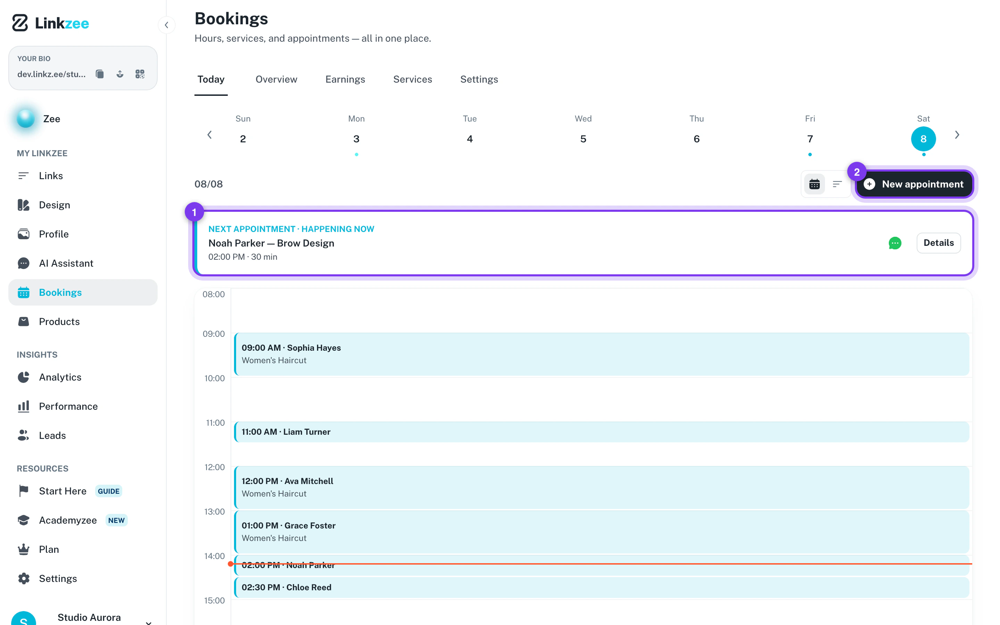

Scheduling lets people **book your services right from your bio**. Turn it on in
**Scheduling** and a booking card appears on your page, so visitors can reserve a
time without leaving your Linkzee.

<Frame caption="Scheduling opens on Today: week strip, next appointment and the day timeline.">
  
</Frame>

## Three setups, one engine

Scheduling adapts to how you work. Pick the setup that matches your business:
they all run on the same underlying engine.

| Mode | Who it's for | How it works |
| --- | --- | --- |
| **Solo** | One person (manicurist, tattoo artist) | Visitors just pick a time. |
| **Team** | Clinics, salons | Each staff member has their own hours and services, and the visitor picks who. |
| **Slots** | Courts, group classes | Several spots are available per time. |

## How visitors book

A booking card appears on your page, styled in your theme. Visitors book in a
simple, step-by-step wizard: they choose what they need, see real available
times, and confirm. Available times follow your **business timezone**, set in **Bookings →
Settings**, so everyone sees the right slots.

<Note>
  Like everything in Linkzee, your scheduling changes save automatically and the
  preview updates live. On desktop it sits on the right; on mobile, tap
  **Preview** in the header to see your page full screen.
</Note>

### The phone field

Every phone field on your page (booking, waitlist, packages and subscriptions,
the customer area and contact forms) shows the **country flag and dialing
code** next to the number. It starts in the visitor's country, detected from
their connection, or else in your business's country. Visitors tap the flag to
pick another country from a list they can search by name or code, and typing a
number that starts with `+` and a dialing code switches the flag on its own.

When a number looks like it belongs to another country, the field suggests
**Use** that country. When it fits both countries, the visitor confirms which
one before sending. This keeps each client under one phone number, so their
bookings, credits and customer area stay together. The device remembers the
country the visitor chose for next time.

### The booking card at the top

The booking card is **pinned to the top of your page**, right below your name.
It's your page's main action. Besides the **Book now** button, it shows the
**next available times** for one service: visitors tap a time and land straight
on the confirmation screen with the service and time already picked.

To choose which service shows there, go to **Links**, open the agenda card and
pick a **Featured service**. On **Automatic**, we show your most booked service
from the last 30 days.

### Hide the booking card

The booking card is on by default. To hide it, go to **Scheduling → Settings**
and turn off **Show booking card at the top of the page**, right below
**Booking active on my page**. Only the card leaves your page: scheduling stays
on, and visitors can still book through:

- your [booking link](/scheduling/booking-link) (`linkz.ee/your-name?agenda=1`);
- the [services menu](/scheduling/services) on your page;
- the **"Book this"** buttons on your [links](/your-page/links) and any other
  button tied to a service or package.

Customers who already booked on their device keep a shortcut at the top: they
see **Your next appointment** when one is coming up, or **My bookings**
otherwise.

<Warning>
  If the services menu is also off, the panel warns you: without the top card,
  clients can only book through your booking link or buttons tied to services.
  Tap **View booking link** to jump to it and share it, so you don't miss
  bookings.
</Warning>

Through the [MCP server](/integrations/mcp/tools-reference), `configure_agenda`
does the same with `showTopCard: false` (or `true` to show the card again).

## Already use Qzee?

If your business runs its appointments on Qzee, you can put your **Qzee agenda**
at the top of your bio instead of the Linkzee agenda. Clients book straight on
Qzee, and your bio takes bookings through one agenda at a time. See
[Qzee agenda on your bio](/scheduling/qzee-booking).

## Set it up

<CardGroup cols={2}>
  <Card title="Services" icon="list-check" href="/scheduling/services">
    Create the services people can book, with duration, price and more.
  </Card>
  <Card title="Business hours" icon="clock" href="/scheduling/business-hours">
    Set when you're available and your booking rules.
  </Card>
  <Card title="Team" icon="users" href="/scheduling/team">
    Add the people who take appointments and the services they offer.
  </Card>
  <Card title="Charge for bookings" icon="credit-card" href="/scheduling/payments">
    Deposit or full amount at booking, paid straight to you.
  </Card>
  <Card title="Earnings & payouts" icon="sack-dollar" href="/scheduling/earnings">
    What you received, who paid, and how it reaches your bank.
  </Card>
  <Card title="Reviews" icon="star" href="/scheduling/reviews">
    Real reviews after each appointment, shown where people book.
  </Card>
  <Card title="Waitlist" icon="user-clock" href="/scheduling/waitlist">
    Cancelled slots offered automatically to the next in line.
  </Card>
  <Card title="Google Calendar" icon="calendar-plus" href="/scheduling/google-calendar">
    Connect your calendar so bookings appear on your phone, with Google Meet.
  </Card>
  <Card title="Session packages" icon="ticket" href="/scheduling/packages">
    Sell bundles of sessions upfront. Credits are used automatically at booking.
  </Card>
  <Card title="Recurring plans" icon="arrows-rotate" href="/scheduling/subscription-plans">
    Monthly or yearly subscriptions with unlimited sessions, credits or discounts.
  </Card>
  <Card title="Customer area" icon="circle-user" href="/scheduling/customer-area">
    A private page where customers track bookings, credits and subscriptions.
  </Card>
  <Card title="Qzee agenda" icon="calendar-days" href="/scheduling/qzee-booking">
    Already on Qzee? Put your Qzee agenda at the top of your bio.
  </Card>
</CardGroup>
