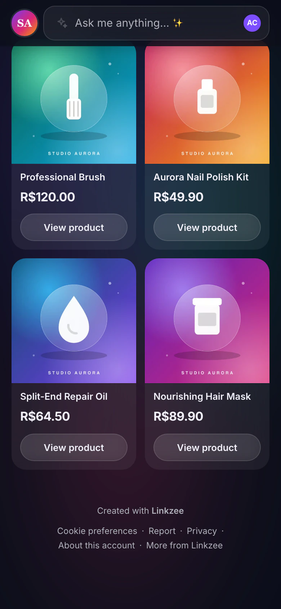

Your page is made to be shared. Linkzee gives you a downloadable **QR code**, a
polished **preview image** for social apps — and, if you want, a **PIX support
card** so visitors can send you a contribution directly.

## QR code

Tap **Share** (in the side menu, or at the top of the screen on your phone) and
then the **QR code** button to download your page's QR code, or to make a
ready-to-print **QR code sign** (A5 sign or square sticker as a PDF for printing,
or Story and Post images for social media). Anyone who scans it lands on your
public page, and the visit shows up in Analytics as **Printed QR**. See
[Tracked links & QR code](/analytics/tracked-links).

## Share preview image

When someone shares your link — on WhatsApp, Instagram, X, anywhere — the app
shows a **preview card generated automatically** with your photo and name.
There's nothing to configure: it updates whenever you change your page header.

## PIX support card (Brazil)

Let visitors support your work with a direct PIX — no intermediary, no fee,
straight to your key:

1. In **My Linkzee → Add**, choose **Support**.
2. Enter your **PIX key** (CPF/CNPJ, email, phone or random key) and, if you
   like, suggested amounts.
3. A support card appears on your page: visitors scan the **QR code** or tap
   **copy code** and pay in their bank app.

<Note>
  The PIX goes **directly from the visitor's bank to yours** — Linkzee never
  touches the money and charges nothing on it. The card can be repositioned on
  your page like any other item.
</Note>

<Frame caption="The PIX support card on your public page: suggested amounts and copy-paste code.">
  
</Frame>
